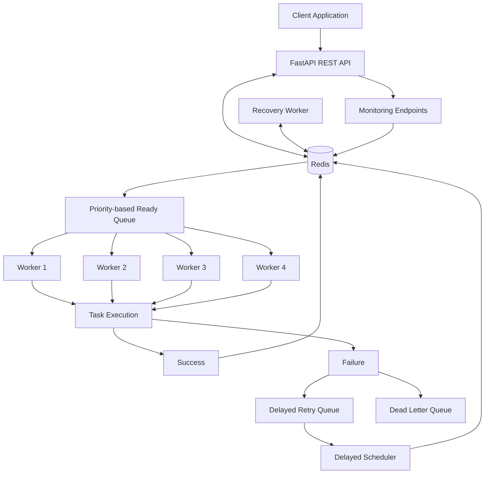

# Mini Task Queue

[](https://github.com/Rahulkarnati2007/mini-task-queue/actions/workflows/tests.yml)

A distributed background task queue built using **Python, FastAPI, and Redis**, supporting concurrent task execution, priority scheduling, automatic retries, crash recovery, and task monitoring.

The project demonstrates core distributed-systems concepts such as concurrency, atomic operations, fault tolerance, lease management, idempotency, and at-least-once task delivery.

**GitHub Repository:** [Mini Task Queue](https://github.com/Rahulkarnati2007/mini-task-queue)

---

## Features

- **Multi-worker execution:** Multiple independent workers process tasks concurrently.
- **Priority scheduling:** Redis Sorted Sets implement priority-based scheduling (0–9), with FIFO ordering among tasks of equal priority.
- **Atomic task reservation:** Redis atomic operations and Lua scripts prevent multiple workers from reserving the same ready task.
- **Automatic retries:** Exponential backoff with jitter and configurable attempt limits.
- **Delayed execution:** Schedule tasks for future execution using a delayed queue and scheduler.
- **Dead Letter Queue (DLQ):** Isolate tasks that exhaust their allowed retry attempts.
- **Crash recovery:** Recover unfinished tasks after worker lease expiration.
- **Lease-based processing:** Workers acquire time-limited leases while executing tasks.
- **Heartbeat mechanism:** Task-level heartbeats renew processing leases, while worker-level heartbeats report worker liveness.
- **Stale-worker protection:** Lease-token validation prevents outdated workers from acknowledging reassigned tasks.
- **Graceful shutdown:** Workers handle shutdown signals safely.
- **Idempotency support:** Redis-backed idempotency keys using atomic `SET NX` operations prevent duplicate task creation when clients retry submissions.
- **Monitoring:** Queue statistics, worker execution metrics, and worker health endpoints.
- **Docker deployment:** Run the complete system using Docker Compose.
- **Continuous integration:** GitHub Actions automatically runs the automated test suite.

## Technology Stack

| Technology | Purpose |
|---|---|
| Python 3.12 | Core programming language |
| FastAPI | REST API |
| Redis 7 | Queue coordination and task storage |
| Redis Sorted Sets | Priority-based scheduling |
| Redis Lua | Atomic queue and state operations |
| Docker | Containerization |
| Docker Compose | Multi-service deployment |
| Pytest | Automated testing |
| GitHub Actions | Continuous integration |

## Architecture



### Core Components

| Component | Responsibility |
|---|---|
| FastAPI | Accepts task submissions and exposes task-management and monitoring endpoints |
| Redis | Stores task information and coordinates queue operations |
| Ready Queue | Maintains tasks in priority and FIFO order |
| Workers | Execute tasks concurrently |
| Delayed Scheduler | Moves scheduled tasks into the ready queue when they become eligible |
| Recovery Worker | Detects expired processing leases and recovers unfinished tasks |
| Dead Letter Queue | Stores tasks that exhaust their retry attempts |

## Project Structure

```text
mini-task-queue/
│
├── .github/
│   └── workflows/
│       └── tests.yml
│
├── app/
│   ├── api/
│   │   ├── health.py
│   │   └── tasks.py
│   │
│   ├── core/
│   │   ├── queue_stats.py
│   │   ├── state_manager.py
│   │   ├── task_service.py
│   │   ├── task.py
│   │   └── worker_metrics.py
│   │
│   ├── storage/
│   │   ├── dead_letter_queue.py
│   │   ├── delayed_queue.py
│   │   ├── processing_queue.py
│   │   ├── ready_queue.py
│   │   ├── redis_client.py
│   │   └── task_storage.py
│   │
│   ├── workers/
│   │   ├── delayed_scheduler.py
│   │   ├── delayed_scheduler_runner.py
│   │   ├── handlers.py
│   │   ├── recovery_runner.py
│   │   ├── recovery_worker.py
│   │   ├── retry_policy.py
│   │   ├── worker.py
│   │   └── worker_runner.py
│   │
│   ├── __init__.py
│   └── main.py
│
├── scripts/
│   ├── redis_test.py
│   ├── test_ready_queue.py
│   └── test_task_service.py
│
├── tests/
│   ├── test_api.py
│   ├── test_atomic_dequeue.py
│   ├── test_dead_letter_queue.py
│   ├── test_delayed_queue_atomic.py
│   ├── test_delayed_queue.py
│   ├── test_delayed_scheduler.py
│   ├── test_idempotency.py
│   ├── test_multi_worker_execution.py
│   ├── test_parallel_worker_execution.py
│   ├── test_processing_queue_concurrency.py
│   ├── test_processing_queue.py
│   ├── test_queue_stats.py
│   ├── test_ready_queue.py
│   ├── test_recovery_worker.py
│   ├── test_retry_policy.py
│   ├── test_state_manager.py
│   ├── test_state_transitions.py
│   ├── test_task_api.py
│   ├── test_task_model.py
│   ├── test_task_service.py
│   ├── test_task_storage.py
│   ├── test_visibility_timeout.py
│   ├── test_worker_health.py
│   ├── test_worker_heartbeat.py
│   ├── test_worker_metrics.py
│   ├── test_worker_processing.py
│   ├── test_worker_restart_shutdown.py
│   ├── test_worker_shutdown.py
│   ├── test_worker.py
│   └── __init__.py
│
├── Dockerfile
├── docker-compose.yml
├── .dockerignore
├── .gitignore
├── pytest.ini
├── requirements.txt
├── load_test_v3.py
└── README.md
```

## Getting Started

### Prerequisites

- Python 3.12+
- Docker Desktop
- Docker Compose

### 1. Clone the Repository

```bash
git clone https://github.com/Rahulkarnati2007/mini-task-queue.git
cd mini-task-queue
```

### 2. Start the Application

```bash
docker compose up --build --scale worker=4 -d
```

This starts:

- Redis
- FastAPI application
- Four worker instances
- Delayed scheduler
- Recovery worker

### 3. Verify Services

```bash
docker compose ps
```

View application logs:

```bash
docker compose logs --tail=50
```

### 4. Access the Application

| Service | URL |
|---|---|
| Swagger API Documentation | http://localhost:8000/docs |
| API Health Check | http://localhost:8000/health |

### 5. Stop the Application

```bash
docker compose down
```

Redis data is persisted using a Docker volume and is retained when containers are stopped and removed using this command.

**Note:** Avoid `docker compose down -v` if you want to preserve Redis data.

## API Endpoints

| Method | Endpoint | Description |
|---|---|---|
| POST | `/tasks` | Submit a task |
| GET | `/tasks` | List tasks |
| GET | `/tasks/{task_id}` | Retrieve task details |
| DELETE | `/tasks/{task_id}` | Cancel a task |
| GET | `/stats` | Queue statistics |
| GET | `/dlq` | View dead-letter tasks |
| POST | `/dlq/{task_id}/requeue` | Requeue a dead-letter task |
| GET | `/workers/metrics` | Worker performance metrics |
| GET | `/workers/health` | Worker health information |
| GET | `/health` | API and Redis health check |

## Example Task Submission

Submit a task using `POST /tasks`.

**Request:**

```json
{
  "task_type": "process_data",
  "payload": {
    "data": [10, 20, 30, 40, 50],
    "operation": "sum"
  },
  "max_attempts": 3
}
```

A successful submission returns HTTP `201` and a unique task ID.

Retrieve task details using:

```text
GET /tasks/{task_id}
```

A successful task follows this lifecycle:

```text
PENDING → RUNNING → SUCCEEDED
```

A task that fails may follow this lifecycle:

```text
PENDING → RUNNING → FAILED → DELAYED → RUNNING
```

Tasks that exhaust their configured retry attempts are moved to the Dead Letter Queue.

## Reliability and Fault Tolerance

### 1. Atomic Task Reservation

Redis atomic operations and Lua scripts ensure that queue reservation and state transitions are protected against concurrent modifications.

### 2. Lease-Based Processing

Workers receive time-limited leases while processing tasks. Lease tokens are used to validate ownership.

### 3. Heartbeat Mechanism

Workers periodically renew their task leases to indicate that they are still processing a task. Separate worker-level heartbeats report process liveness.

### 4. Crash Recovery

The recovery worker detects expired leases and recovers unfinished tasks. Attempt limits are enforced during recovery to prevent unlimited re-execution.

### 5. Retry Mechanism

Failed tasks are retried using exponential backoff and jitter, subject to configurable attempt limits.

### 6. Dead Letter Queue

Tasks that exhaust their allowed attempts are moved to the DLQ for inspection or manual reprocessing.

### 7. Stale Worker Protection

Lease-token validation prevents workers with outdated reservations from acknowledging tasks after lease reassignment.

### 8. Idempotency

Redis `SET NX` operations ensure that only one task claims a given idempotency key. Repeated submissions using the same key return the existing task instead of creating another one.

**Delivery semantics:** The system provides at-least-once execution. A task may execute more than once under certain failure conditions, so task handlers should be idempotent where necessary. This is not an exactly-once execution system.

## Testing

Run the automated test suite locally:

```bash
python -m pytest -v
```

**Development testing:** All 55 automated tests passed.

**Continuous Integration:** GitHub Actions automatically runs the test suite on pushes and pull requests.

[View GitHub Actions Workflows](https://github.com/Rahulkarnati2007/mini-task-queue/actions)

## Load Testing

A load test was conducted using **1,000 `process_data` tasks** and four workers.

### Benchmark Results

| Metric | Result |
|---|---:|
| Tasks submitted | 1,000 |
| Tasks succeeded | 1,000 |
| Failed / dead / timed out | 0 |
| Submission errors | 0 |
| Polling errors | 0 |
| Submission throughput | 57.46 tasks/sec |
| Completion throughput | 3.59 tasks/sec |
| Average submission latency | 0.335 sec |
| P95 submission latency | 0.682 sec |

All 1,000 tasks were successfully processed without submission or polling errors.

*Results were obtained in a local development environment using four workers. Performance may vary depending on hardware, worker count, and task workload.*

## Design Decisions

- **Redis:** Provides fast queue operations and atomic Lua-script execution.
- **Redis Sorted Sets:** Enable priority scheduling with FIFO ordering among tasks of equal priority.
- **Multiple workers:** Enable concurrent task processing.
- **Lease-based recovery:** Helps handle worker crashes and abandoned tasks.
- **Retry limits:** Prevent infinite retry loops.
- **Dead Letter Queue:** Isolates repeatedly failing tasks.
- **Idempotency keys:** Protect against duplicate task creation during client retries.
- **At-least-once delivery:** Supports recovery from execution failures without claiming exactly-once processing.

## Future Improvements

- Authentication and authorization.
- Distributed tracing and structured logging.
- Rate limiting.
- Advanced monitoring dashboard.
- Configurable idempotency-key expiration and cleanup.
- Additional task handlers.
- Production deployment and horizontal scaling.

## Author

**Rahul Karnati**

- GitHub: [Rahulkarnati2007](https://github.com/Rahulkarnati2007)
- Project: [Mini Task Queue](https://github.com/Rahulkarnati2007/mini-task-queue)